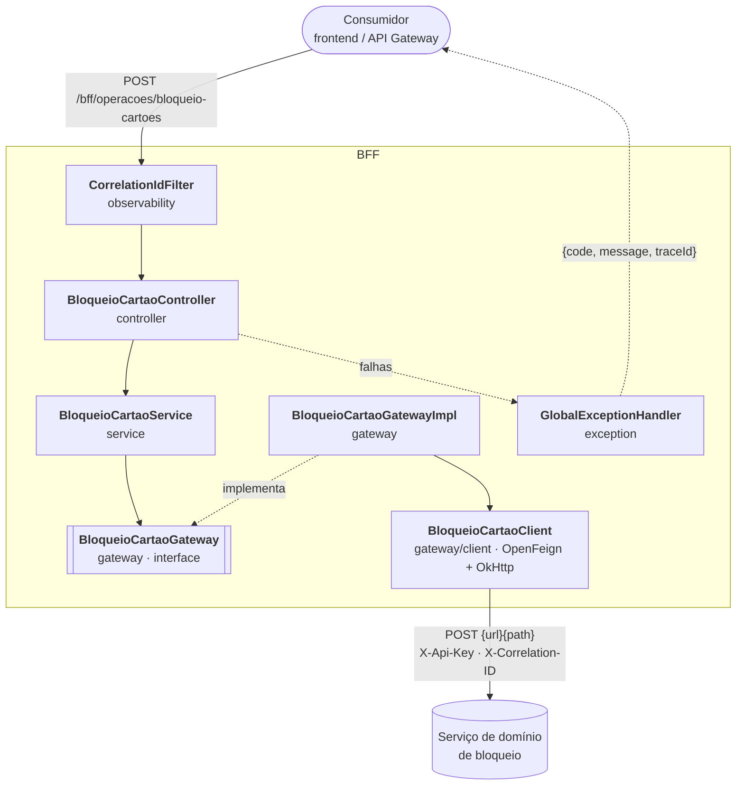
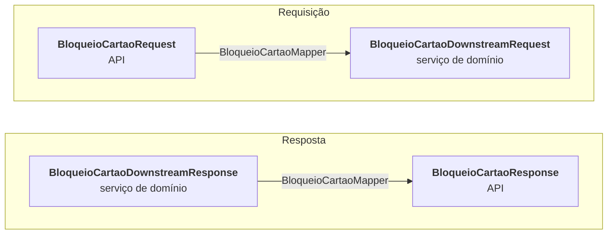

# BFF de Bloqueio de Cartões

Backend for Frontend (BFF) que recebe solicitações de bloqueio de portadores vinculados a um cartão, valida a entrada e encaminha a operação para o serviço de domínio de bloqueio.

> **Fora do escopo:** frontend, testes E2E e pipelines de CI/CD não são documentados nem implementados neste projeto. A autorização do consumidor também está fora do escopo deste scaffold (veja [Autenticação](#autenticação)).

## Sumário

- [Objetivo](#objetivo)
- [Arquitetura](#arquitetura)
- [Responsabilidades](#responsabilidades)
- [Fluxo do endpoint](#fluxo-do-endpoint)
- [Endpoint](#endpoint)
- [Autenticação](#autenticação)
- [Pré-requisitos](#pré-requisitos)
- [Configuração externa](#configuração-externa)
- [Configuração da integração](#configuração-da-integração)
- [Timeouts e tratamento de erros](#timeouts-e-tratamento-de-erros)
- [Logs](#logs)
- [Trace / correlation ID](#trace--correlation-id)
- [Execução local](#execução-local)
- [Testes](#testes)
- [Troubleshooting](#troubleshooting)

## Objetivo

Disponibilizar ao frontend um contrato próprio para criar uma **operação de bloqueio** de um ou mais portadores de um cartão. O BFF adapta o contrato, valida o formato da entrada, orquestra a chamada ao serviço de domínio e protege o consumidor de detalhes internos da integração.

O BFF **não** contém regra de negócio de bloqueio, não persiste dados e não acessa banco: essas responsabilidades pertencem ao serviço de domínio.

## Arquitetura

### Camadas

As setas contínuas mostram quem chama quem; as tracejadas mostram a implementação da interface e o caminho das falhas.



O `BloqueioCartaoService` depende só da interface `BloqueioCartaoGateway`, que fica no pacote `gateway`. A implementação, o client Feign e a configuração HTTP também ficam nesse pacote e em `config/feign`. O service conhece os DTOs do serviço de domínio (por meio do mapper), mas não conhece HTTP nem Feign. Só o gateway fala com o serviço de domínio.

### Contratos por camada

A API e o serviço de domínio têm contratos separados. O `BloqueioCartaoMapper` (MapStruct) converte entre eles nos dois sentidos. Não existe mais um modelo de domínio intermediário: o request da API é convertido direto para o DTO do serviço de domínio.



| Camada | Pacote | Requisição | Resposta |
|---|---|---|---|
| API | `controller/dto` | `BloqueioCartaoRequest` | `BloqueioCartaoResponse` |
| Serviço de domínio | `gateway/dto` | `BloqueioCartaoDownstreamRequest` | `BloqueioCartaoDownstreamResponse` |

O enum `TipoBloqueio` (pacote `model`) é compartilhado pelo request da API e pelo request do serviço de domínio. Trocar um valor do enum altera os dois contratos ao mesmo tempo.

**Contrato da API ≠ contrato do serviço de domínio.** Uma mudança no contrato da API fica restrita a `controller/dto`. Uma mudança no contrato do serviço de domínio fica restrita a `gateway/dto`. Nenhum dos dois atinge o outro, porque o `BloqueioCartaoMapper` é o único ponto de conversão entre eles.

**Atenção:** com `unmappedTargetPolicy = ReportingPolicy.ERROR`, se um campo novo for adicionado ao DTO do serviço de domínio e não tiver origem no request da API, o build falha. Isso é intencional: o erro aparece na compilação, não em produção.

### Padrão de mapeamento

- Todas as conversões entre contratos usam MapStruct, com `@Mapper(componentModel = "spring", unmappedTargetPolicy = ReportingPolicy.ERROR)`.
- Não há mapper manual. Campo sem origem correspondente quebra o build.
- **DTO downstream de requisição**: o gateway recebe sempre um `BloqueioCartaoDownstreamRequest`, mesmo quando os campos são iguais aos do request da API. Essa separação existe para que uma mudança no contrato do serviço de domínio não toque na API. Se o serviço de domínio passar a exigir outro formato, ajuste só o DTO e o mapper.

### Padrão Lombok

- **Dados são `record`**: DTOs e propriedades de configuração (`@ConfigurationProperties`) não usam Lombok.
- **Lombok só onde record não serve**: `@RequiredArgsConstructor` para injeção por construtor em beans, `@Slf4j` para logger, `@Getter` em exceções/enums e `@NoArgsConstructor(access = PRIVATE)` em classes de constantes.
- **Não usar** `@Data`, `@Setter`, `@SneakyThrows`, `@UtilityClass` nem `@Builder` sem necessidade real.
- O `lombok.config` marca o código gerado com `@Generated`, que o JaCoCo ignora na cobertura.

### Pacotes

```text
src/main/java/br/com/empresa/bff/
├── Application.java
├── controller/                 Endpoint REST
│   ├── BloqueioCartaoApi         Interface com o contrato OpenAPI (anotações Swagger)
│   ├── BloqueioCartaoController  Implementa a interface; só mapeia a rota
│   └── dto/
│       ├── request/              BloqueioCartaoRequest, PortadorRequest
│       └── response/             BloqueioCartaoResponse
├── service/                    BloqueioCartaoService  (orquestra: mapeia, chama o gateway, mapeia a resposta)
│                               BloqueioCartaoMapper   (MapStruct: API ↔ serviço de domínio)
├── model/                      TipoBloqueio  (enum compartilhado pelo request da API e do serviço de domínio)
├── gateway/                    BloqueioCartaoGateway      (interface, porta de saída)
│   ├── BloqueioCartaoGatewayImpl  (traduz falhas do Feign em DownstreamIntegrationException)
│   ├── client/                   BloqueioCartaoClient   (OpenFeign)
│   └── dto/                      BloqueioCartaoDownstreamRequest, BloqueioCartaoDownstreamResponse
├── config/
│   ├── OpenApiConfig             Componentes compartilhados do OpenAPI (respostas de erro)
│   └── feign/                    Transporte OkHttp, headers, retry, decodificação de erros e
│                                 propriedades tipadas (BloqueioCartaoProperties)
├── exception/                  ErrorCode, DownstreamIntegrationException, GlobalExceptionHandler
└── observability/              Correlation ID: filtro, header e chave de MDC
```

A estrutura não tem pacotes vazios. Os pacotes `security` e `validation`, que existiam como placeholders, foram removidos. Se a autenticação do consumidor for necessária, ela entra em um pacote novo, junto com os códigos de erro e as respostas OpenAPI correspondentes.

## Responsabilidades

| Componente | Responsável por | Não deve |
|---|---|---|
| `BloqueioCartaoApi` | Declarar o contrato OpenAPI do endpoint (anotações Swagger e validação `@Valid`). | Conter lógica. |
| `BloqueioCartaoController` | Implementar a `BloqueioCartaoApi`, mapear a rota `POST /operacoes/bloqueio-cartoes` e responder `202`. | Conter regra de negócio ou chamar o client. |
| `BloqueioCartaoService` | Coordenar a jornada: mapear o request para o serviço de domínio, chamar o gateway e mapear a resposta. | Conhecer detalhes HTTP. |
| `BloqueioCartaoMapper` | Converter `BloqueioCartaoRequest` para `BloqueioCartaoDownstreamRequest` e `BloqueioCartaoDownstreamResponse` para `BloqueioCartaoResponse` (MapStruct). | — |
| `BloqueioCartaoGatewayImpl` | Chamar o client com o DTO do serviço de domínio e traduzir falhas de integração do Feign. Só trata `RetryableException` e `DecodeException`. | Capturar erros que não são de integração (bugs e falhas de serialização do próprio BFF). |
| `BloqueioCartaoClient` | Comunicação HTTP com o serviço de domínio. | Conter regra de negócio. |
| `BloqueioCartaoFeignConfig` | Transporte OkHttp, `X-Api-Key`, propagação do correlation ID, desligar retry e decodificar respostas de erro. | — |
| `GlobalExceptionHandler` | Converter exceções no contrato de erro `{code, message, traceId}`. | Retornar stack trace ou dados internos. |
| `CorrelationIdFilter` | Garantir um correlation ID por requisição, gravar no MDC, devolver no header e registrar o log de acesso. | — |

## Fluxo do endpoint

1. O `CorrelationIdFilter` obtém ou gera o `X-Correlation-ID` e o grava no MDC.
2. O `BloqueioCartaoController` recebe o `BloqueioCartaoRequest`. A validação (`@Valid`) é feita antes do método, pela interface. Payload inválido → `400`.
3. O `BloqueioCartaoService` usa o `BloqueioCartaoMapper` para converter o request em `BloqueioCartaoDownstreamRequest`.
4. O `BloqueioCartaoGatewayImpl` chama o `BloqueioCartaoClient` com o `BloqueioCartaoDownstreamRequest`.
5. O client envia `POST {url}{path}` ao serviço de domínio com `X-Api-Key` e `X-Correlation-ID`.
6. A resposta do downstream (`BloqueioCartaoDownstreamResponse`) é convertida para `BloqueioCartaoResponse` pelo mesmo `BloqueioCartaoMapper`.
7. O BFF responde `202 Accepted` com o protocolo e o status da operação.
8. Em qualquer falha, o `GlobalExceptionHandler` responde com o contrato de erro padronizado (veja [Timeouts e tratamento de erros](#timeouts-e-tratamento-de-erros)).

## Endpoint

| Item | Valor |
|---|---|
| Método e rota | `POST /bff/operacoes/bloqueio-cartoes` (context path `/bff`) |
| Content-Type | `application/json` |
| Header opcional | `X-Correlation-ID` |
| Resposta de sucesso | `202 Accepted` (operação assíncrona) |
| Documentação | Swagger UI em `/bff/swagger-ui.html` e JSON em `/bff/v3/api-docs` |

### Requisição

```json
{
  "cartaoId": "123456",
  "tipoBloqueio": "DEFINITIVO",
  "motivo": "SOLICITACAO_CLIENTE",
  "portadores": [
    { "portadorId": "987654" },
    { "portadorId": "456789" }
  ]
}
```

| Campo | Tipo | Obrigatório | Regra |
|---|---|---|---|
| `cartaoId` | string | Sim | Não pode ser vazio. |
| `tipoBloqueio` | enum | Sim | `TEMPORARIO` ou `DEFINITIVO`. Outros valores retornam `400`. |
| `motivo` | string | Não | Texto livre. |
| `portadores` | array | Sim | Ao menos um portador. |
| `portadores[].portadorId` | string | Sim | Não pode ser vazio. |

### Resposta de sucesso — `202 Accepted`

```json
{
  "protocoloId": "8f6d2c10",
  "status": "PROCESSING"
}
```

`protocoloId` e `status` são repassados do serviço de domínio sem alteração.

### Resposta de erro

Todas as falhas usam o mesmo contrato, sem stack trace nem detalhes do downstream:

```json
{
  "code": "DOWNSTREAM_TIMEOUT",
  "message": "Tempo limite do serviço excedido",
  "traceId": "corr-123"
}
```

Os códigos possíveis estão em [Timeouts e tratamento de erros](#timeouts-e-tratamento-de-erros).

## Autenticação

**BFF → serviço de domínio.** Toda chamada ao downstream leva o header `X-Api-Key`, preenchido pelo próprio BFF a partir de `bloqueio-cartao.api-key` (variável `BLOQUEIO_SERVICE_API_KEY`). A chave é configurada somente no servidor: o consumidor **não** deve enviá-la.

**Consumidor → BFF.** Fora do escopo deste scaffold: o BFF não autentica nem autoriza o consumidor, e o endpoint não retorna `401` nem `403`. Um BFF derivado que precise de autorização deve aplicá-la no `BloqueioCartaoService`, antes da chamada ao gateway, como prevê o padrão de BFF, e incluir os códigos de erro e as respostas correspondentes no contrato e no OpenAPI.

## Pré-requisitos

| Item | Versão / observação |
|---|---|
| JDK | 25 ou superior (validado no build pelo `maven-enforcer-plugin`) |
| Maven | Não precisa instalar: use o wrapper `mvnw` / `mvnw.cmd` (Maven 3.9+) |
| Acesso ao Maven Central | Para baixar dependências na primeira execução |
| Serviço de domínio e API key | Apenas para executar a aplicação contra um downstream real. **Os testes não precisam.** |

## Configuração externa

URLs, timeouts e credenciais vêm de configuração externa (`src/main/resources/application.yml`) e podem ser sobrescritos por variáveis de ambiente. Segredos não devem ser versionados: em ambientes reais, `BLOQUEIO_SERVICE_API_KEY` deve vir do mecanismo de secrets management.

| Variável | Propriedade | Padrão | Descrição |
|---|---|---|---|
| `SERVER_PORT` | `server.port` | `8080` | Porta HTTP do BFF. |
| `BLOQUEIO_SERVICE_BASE_URL` | `spring.cloud.openfeign.client.config.bloqueioCartao.url` | `http://localhost:8081` | URL base do serviço de domínio. |
| `BLOQUEIO_SERVICE_PATH` | `bloqueio-cartao.path` | `/api/v1/bloqueios-cartao` | Rota do serviço de domínio. |
| `BLOQUEIO_SERVICE_API_KEY` | `bloqueio-cartao.api-key` | **obrigatória** | Valor do header `X-Api-Key`. |
| `BLOQUEIO_SERVICE_CONNECT_TIMEOUT` | `...bloqueioCartao.connectTimeout` | `3000` | Timeout de conexão (ms). |
| `BLOQUEIO_SERVICE_TIMEOUT` | `...bloqueioCartao.readTimeout` | `5000` | Timeout de leitura (ms). |
| `ENV_HTTPCLIENT_CONFIG_DEFAULT_WRITE_TIMEOUT` | `bloqueio-cartao.okhttp.write-timeout-millis` | `5000` | Timeout de escrita do OkHttp (ms). |
| `ENV_OKHTTPCLIENT_POOL_MAX_IDLE_CONNECTIONS` | `bloqueio-cartao.okhttp.connection-pool.max-idle-connections` | `20` | Conexões ociosas mantidas no pool. |
| `ENV_OKHTTPCLIENT_POOL_KEEP_ALIVE_DURATION_SEGUNDOS` | `bloqueio-cartao.okhttp.connection-pool.keep-alive-duration-segundos` | `60` | Tempo de vida de uma conexão ociosa (s). |
| `ENV_OKHTTPCLIENT_DISPATCHER_MAX_REQUESTS` | `bloqueio-cartao.okhttp.dispatcher.max-requests` | `64` | Limite do dispatcher do OkHttp.¹ |
| `ENV_OKHTTPCLIENT_DISPATCHER_MAX_REQUESTS_PER_HOST` | `bloqueio-cartao.okhttp.dispatcher.max-requests-per-host` | `5` | Limite por host do dispatcher do OkHttp.¹ |
| `LOG_LEVEL_ROOT` | `logging.level.root` | `INFO` | Nível de log geral. |
| `LOG_LEVEL_BR_COM_EMPRESA` | `logging.level.br.com.empresa.bff` | `DEBUG` | Nível de log da aplicação. |
| `LOG_LEVEL_OKHTTP3` | `logging.level.okhttp3` | `OFF` | Nível de log do OkHttp. |
| `LOG_LEVEL_ORG_SPRINGFRAMEWORK` | `logging.level.org.springframework` | `INFO` | Nível de log do Spring. |

¹ Os limites do dispatcher só valem para chamadas assíncronas do OkHttp. O Feign faz chamadas síncronas, então esses valores **não** limitam a concorrência com o downstream.

### Profile `local`

O profile `local` (`application-local.yml`) define `BLOQUEIO_SERVICE_API_KEY` como `dummy-key` quando a variável não está presente, permitindo subir a aplicação sem credencial real. Não use esse profile fora do desenvolvimento.

## Configuração da integração

O `BloqueioCartaoClient` é uma interface OpenFeign registrada com o nome `bloqueioCartao` e configurada por `BloqueioCartaoFeignConfig`:

| Aspecto | Comportamento |
|---|---|
| Transporte | OkHttp com pool de conexões próprio (`feign-okhttp`). |
| Requisição | `POST {BLOQUEIO_SERVICE_BASE_URL}{BLOQUEIO_SERVICE_PATH}` com corpo JSON. |
| Headers enviados | `X-Api-Key` (sempre) e `X-Correlation-ID` (quando existe no MDC, ou seja, em toda requisição recebida pelo BFF). |
| Retry | Desligado (`Retryer.NEVER_RETRY` e `retry-on-connection-failure: false`): uma requisição ao BFF gera exatamente uma chamada ao downstream. |
| Respostas de erro | O `ErrorDecoder` converte qualquer status ≥ 400 em `DownstreamIntegrationException`, com o status original e o corpo da resposta como mensagem. |
| Traduções de falha | O `BloqueioCartaoGatewayImpl` converte `RetryableException` (timeout → `504`, outras → `503`) e `DecodeException` (→ `502`). Outras exceções não são capturadas e viram `500`. `EncodeException` também não é capturada: significa erro na serialização do request, não no downstream. |
| Propriedades | Centralizadas em `BloqueioCartaoProperties` (`@ConfigurationProperties("bloqueio-cartao")`, com `okhttp.connection-pool` e `okhttp.dispatcher` aninhados), registrada só no contexto deste client. |

Contrato enviado ao serviço de domínio (`BloqueioCartaoDownstreamRequest`):

```json
{
  "cartaoId": "123456",
  "tipoBloqueio": "DEFINITIVO",
  "motivo": "SOLICITACAO_CLIENTE",
  "portadores": [{ "portadorId": "987654" }]
}
```

Contrato esperado do serviço de domínio (qualquer status 2xx):

```json
{ "protocoloId": "8f6d2c10", "status": "PROCESSING" }
```

## Timeouts e tratamento de erros

| Timeout | Padrão | Variável |
|---|---|---|
| Conexão | 3000 ms | `BLOQUEIO_SERVICE_CONNECT_TIMEOUT` |
| Leitura | 5000 ms | `BLOQUEIO_SERVICE_TIMEOUT` |
| Escrita | 5000 ms | `ENV_HTTPCLIENT_CONFIG_DEFAULT_WRITE_TIMEOUT` |

Mapeamento de falhas para o consumidor:

| Situação | Status | `code` |
|---|---|---|
| Payload inválido, JSON malformado ou enum desconhecido | `400` | `VALIDATION_ERROR` |
| Timeout de conexão ou leitura, ou downstream respondeu `504` | `504` | `DOWNSTREAM_TIMEOUT` |
| Falha de conexão (recusada, reset, DNS), ou downstream respondeu `503` | `503` | `DOWNSTREAM_UNAVAILABLE` |
| Downstream respondeu outro erro (4xx/5xx) ou uma resposta ilegível | `502` | `DOWNSTREAM_ERROR` |
| Falha inesperada no BFF | `500` | `INTERNAL_ERROR` |

Um `401` ou `403` vindo do **downstream** (por exemplo, API key inválida) é tratado como erro de integração e retorna `502`, não `401`/`403`.

## Logs

Os logs vão para o console no formato:

```text
%d{yyyy-MM-dd HH:mm:ss} [%X{correlationId}] [%thread] %-5level %logger %kvp - %msg%n
```

O campo entre colchetes é o correlation ID da requisição, e `%kvp` imprime os atributos estruturados do evento. A aplicação registra:

| Evento | Nível | Origem | Atributos |
|---|---|---|---|
| Fim de cada requisição HTTP | `INFO` | `CorrelationIdFilter` | `event=http_request_completed`, `method`, `status`, `traceId`, `durationMs` |
| Requisição rejeitada com erro | `WARN` (4xx) / `ERROR` (5xx) | `GlobalExceptionHandler` | `code`, `status`, `traceId` |

Exemplo de uma chamada com o downstream fora do ar:

```text
2026-10-09 23:06:51 [corr-123] [http-nio-8080-exec-2] ERROR br.com.empresa.bff.exception.GlobalExceptionHandler code="DOWNSTREAM_UNAVAILABLE" status="503" traceId="corr-123" - Requisição rejeitada
2026-10-09 23:06:51 [corr-123] [http-nio-8080-exec-2] INFO  br.com.empresa.bff.observability.CorrelationIdFilter event="http_request_completed" method="POST" status="503" traceId="corr-123" durationMs="35" - Requisição finalizada
```

Os logs não incluem o payload da requisição, a API key nem o corpo das respostas de erro do downstream. O status de erro do downstream não é registrado: para investigar uma falha de integração, procure o `traceId` nos logs do serviço de domínio.

## Trace / correlation ID

| Etapa | Comportamento |
|---|---|
| Entrada | O `CorrelationIdFilter` lê o header `X-Correlation-ID`. Valores aceitos: até 128 caracteres entre letras ASCII, números, `.`, `_` e `-`. Se o header estiver ausente ou for inválido, o BFF gera um UUID. |
| Contexto | O valor é gravado no MDC com a chave `correlationId` e aparece em todas as linhas de log da requisição. |
| Downstream | O interceptor do Feign envia o mesmo valor no header `X-Correlation-ID`. |
| Resposta | O BFF devolve o header `X-Correlation-ID` em todas as respostas, inclusive de erro. |
| Erro | O mesmo valor aparece no campo `traceId` do contrato de erro. |

Para rastrear uma requisição de ponta a ponta, filtre os logs do BFF e do serviço de domínio pelo mesmo correlation ID.

## Execução local

Comandos em PowerShell, a partir da raiz do projeto. No Linux/macOS, use `./mvnw` no lugar de `./mvnw.cmd`.

### 1. Gerar o pacote

```powershell
./mvnw.cmd clean package
```

### 2. Executar

Com um serviço de domínio real:

```powershell
$env:BLOQUEIO_SERVICE_BASE_URL="http://localhost:8081"
$env:BLOQUEIO_SERVICE_API_KEY="<sua-api-key>"
java -jar target\bradesco-0.0.1-SNAPSHOT.jar
```

Sem credencial real, para explorar a API e o OpenAPI:

```powershell
java -jar target\bradesco-0.0.1-SNAPSHOT.jar --spring.profiles.active=local
```

Também é possível executar sem gerar o jar: `./mvnw.cmd spring-boot:run "-Dspring-boot.run.profiles=local"`.

A aplicação sobe em `http://localhost:8080/bff`:

- Swagger UI: `http://localhost:8080/bff/swagger-ui.html`
- OpenAPI JSON: `http://localhost:8080/bff/v3/api-docs`

### 3. Chamar o endpoint

O corpo é enviado a partir de um arquivo, o que funciona igual no Windows PowerShell 5.1 e no PowerShell 7 (as duas versões tratam aspas de forma diferente quando o JSON vai direto na linha de comando):

```powershell
@'
{"cartaoId":"123456","tipoBloqueio":"DEFINITIVO","motivo":"SOLICITACAO_CLIENTE","portadores":[{"portadorId":"987654"}]}
'@ | Set-Content -Encoding ascii bloqueio.json

curl.exe -i -X POST "http://localhost:8080/bff/operacoes/bloqueio-cartoes" `
  -H "Content-Type: application/json" `
  -H "X-Correlation-ID: corr-123" `
  -d "@bloqueio.json"
```

Sem um serviço de domínio na URL configurada, a resposta esperada é `503 DOWNSTREAM_UNAVAILABLE`, com o header `X-Correlation-ID: corr-123` e `"traceId":"corr-123"` no corpo.

## Testes

Os testes seguem os níveis do padrão BFF e **não dependem de nenhum serviço externo**: o downstream é simulado pelo WireMock em porta dinâmica, e nenhuma variável de ambiente é necessária.

| Nível | Pacote (`src/test/java/br/com/empresa/bff`) | Ferramentas | O que valida |
|---|---|---|---|
| Unitário | `unit` | JUnit 5, Mockito | `BloqueioCartaoService`, `BloqueioCartaoMapper`, gateway (tradução de falhas), configuração do Feign, exception handler. |
| Componente | `component` | `@WebMvcTest`, MockMvc | Controller: status HTTP, validação, serialização/desserialização, contrato de erro, correlation ID. |
| Integração | `integration` | `@SpringBootTest` + WireMock | BFF real → HTTP client → downstream simulado: método, rota, headers, payload, `202`, erros HTTP, timeout, falha de conexão, ausência de retry e contrato OpenAPI. |

### Fixtures JSON reutilizáveis

Os dados compartilhados ficam em [`src/test/resources/fixtures/bloqueio-cartao`](src/test/resources/fixtures/bloqueio-cartao):

- `request-with-reason.json`: bloqueio definitivo com motivo e dois portadores;
- `request-without-reason.json`: bloqueio temporário sem o campo opcional `motivo`;
- `response-processing.json`: resultado de processamento com protocolo.

O utilitário de teste [`JsonFixtures`](src/test/java/br/com/empresa/bff/support/JsonFixtures.java) usa caminhos relativos a `fixtures/` e permite carregar o mesmo JSON como DTO/modelo ou como corpo HTTP:

```java
var request = JsonFixtures.read("bloqueio-cartao/request-with-reason.json", BloqueioCartaoRequest.class);
var body = JsonFixtures.json("bloqueio-cartao/request-with-reason.json");
```

Cada chamada a `read` desserializa uma nova instância, sem compartilhar objetos mutáveis entre testes e sem iniciar o Spring. Arquivos ausentes, ilegíveis, com campos desconhecidos ou incompatíveis com o tipo solicitado falham com `AssertionError`.

### Comandos

```powershell
# Todos os testes + relatório e validação de cobertura + regras de build
./mvnw.cmd clean verify

# Somente um nível (o filtro precisa usar "/" e não ".")
./mvnw.cmd test "-Dtest=br/com/empresa/bff/unit/**"
./mvnw.cmd test "-Dtest=br/com/empresa/bff/component/**"
./mvnw.cmd test "-Dtest=br/com/empresa/bff/integration/**"

# Uma classe específica
./mvnw.cmd test "-Dtest=BloqueioCartaoIntegrationTest"
```

Resultados por classe: `target\surefire-reports\`.

### Cobertura (JaCoCo)

Qualquer execução de testes gera o relatório em `target\site\jacoco\`:

- `index.html`: relatório navegável;
- `jacoco.xml`: formato consumido pelo Sonar;
- `jacoco.csv`: resumo por classe.

O `verify` falha se a cobertura ficar abaixo do mínimo:

| Métrica | Mínimo | Propriedade no `pom.xml` |
|---|---|---|
| Linhas | 80% | `jacoco.line.minimum` |
| Branches | 80% | `jacoco.branch.minimum` |

A classe `Application` (bootstrap do Spring) fica fora da medição. O `pom.xml` ainda cita o nome antigo `BradescoApplication.class` na exclusão do JaCoCo, por isso ela não tem efeito hoje.

### Regras de build

O `maven-enforcer-plugin` falha o build se:

- o JDK for anterior ao 25 ou o Maven anterior ao 3.9;
- houver dependência declarada em duplicidade no `pom.xml`;
- houver dependência de persistência (JPA, JDBC, Hibernate), pois o BFF não acessa banco.

## Troubleshooting

| Sintoma | Causa provável | O que fazer |
|---|---|---|
| A aplicação não sobe: `Could not resolve placeholder 'BLOQUEIO_SERVICE_API_KEY'` | `BLOQUEIO_SERVICE_API_KEY` não definida. | Defina a variável ou, só em desenvolvimento, use `--spring.profiles.active=local`. |
| A aplicação não sobe: `Port 8080 was already in use` | Outra aplicação na porta. | Defina `SERVER_PORT` com outra porta. |
| Build falha em `RequireJavaVersion` | JDK anterior ao 25. | Instale o JDK 25 e ajuste `JAVA_HOME`. |
| Build falha em `jacoco:check` (`Coverage checks have not been met`) | Cobertura abaixo do mínimo. | Abra `target\site\jacoco\index.html` e cubra as linhas e branches indicados. |
| `-Dtest=br.com.empresa.bff.unit.**` executa todos os testes | Filtro com `.` não é reconhecido como pacote. | Use `/`: `-Dtest=br/com/empresa/bff/unit/**`. |
| `400 VALIDATION_ERROR` | Campo obrigatório ausente, lista de portadores vazia, `tipoBloqueio` inválido ou JSON malformado. | Confira as regras em [Requisição](#requisição). Para campo ausente ou vazio, a `message` indica o campo; para `tipoBloqueio` inválido ou JSON malformado, a mensagem é genérica (`Erro de validação`). |
| `503 DOWNSTREAM_UNAVAILABLE` | Serviço de domínio fora do ar, URL errada, ou o downstream respondeu `503`. | Verifique `BLOQUEIO_SERVICE_BASE_URL`, a disponibilidade do serviço, proxy e firewall. |
| `504 DOWNSTREAM_TIMEOUT` | O downstream não respondeu dentro do timeout, ou respondeu `504`. | Verifique a latência do serviço antes de aumentar `BLOQUEIO_SERVICE_TIMEOUT` / `BLOQUEIO_SERVICE_CONNECT_TIMEOUT`. |
| `502 DOWNSTREAM_ERROR` | O downstream respondeu um erro (inclusive `401`/`403` por API key inválida, ou `404` por path errado) ou um JSON fora do contrato. | Confira `BLOQUEIO_SERVICE_API_KEY` e `BLOQUEIO_SERVICE_PATH`, e procure o `traceId` nos logs do serviço de domínio. |
| `500 INTERNAL_ERROR` | Falha inesperada no BFF, inclusive erro de serialização do request. | Procure o `traceId` nos logs do BFF: o stack trace da causa aparece no log em nível `ERROR`. |
| Não encontro a requisição nos logs do downstream | Busca feita pelo ID errado. | Use o valor do header `X-Correlation-ID` (ou do `traceId` do erro): é o mesmo enviado ao downstream. |
